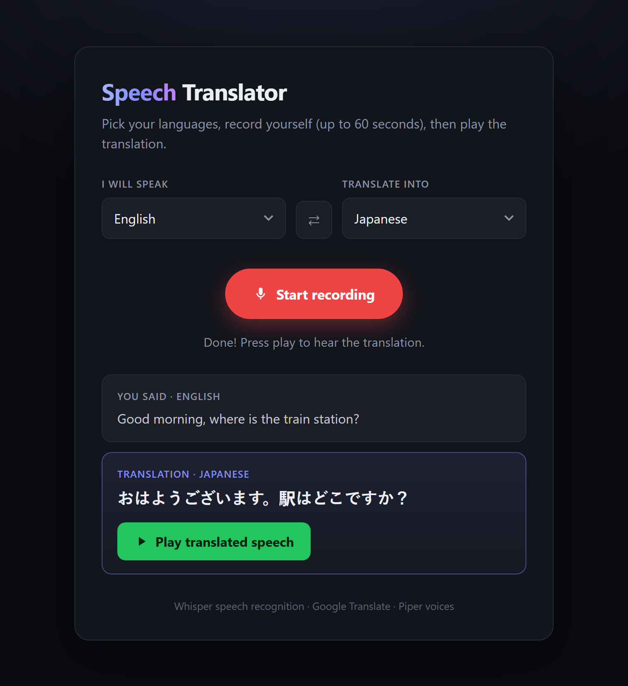

# Speech Translator

Speak into your microphone in one language and hear it spoken back in another.
It runs as a web app in your browser or as a terminal script.

<p align="center">
  
</p>

**13 languages:** English, Spanish, French, Portuguese, German, Italian, Chinese,
Japanese, Korean, Russian, Arabic, Hindi, Dutch.

## How it works

```
Microphone → Whisper → Google Translate → Piper → translated speech
          (speech → text)  (text → text)   (text → speech)
```

1. **Speech to text:** [faster-whisper](https://github.com/SYSTRAN/faster-whisper) runs OpenAI's Whisper
   ("base" model) locally to transcribe the recording.
2. **Translation:** the [Google Cloud Translation API](https://cloud.google.com/translate) translates the text.
3. **Text to speech:** [Piper](https://github.com/OHF-Voice/piper1-gpl) neural voices, also running
   locally, speak the translation (one voice model per language).

Speech recognition and speech synthesis run entirely on your computer; only the translation
step uses the internet.

## Setup

Requires Python 3.12 (other 3.10+ versions should also work).

```bash
pip install -r requirements.txt
python download_voices.py
```

`download_voices.py` fetches the 13 Piper voices (~820 MB) into `voices/`.

Then add a Google Cloud Translation API key:

1. Create a project in the [Google Cloud Console](https://console.cloud.google.com),
   enable the **Cloud Translation API**, and create an API key.
2. Copy `key.env.example` to `key.env` and paste your key into it.

`key.env` is ignored by git, so the key is never committed.

## Usage

### Web app

```bash
python web_app.py
```

Open <http://localhost:8000>, pick the language you'll speak and the language to translate into,
press **Start recording**, speak, press **Stop recording**, then **Play translated speech**.

### Terminal

```bash
python speak.py --src en --tgt es
```

Press Enter to start recording and Enter again to stop. The recording and the translated speech are
saved to `output/latest_input.wav` and `output/latest_translation.wav`.

## Limits and safeguards

- Recordings are capped at 60 seconds (the page stops automatically) and uploads at 5 MB.
- Translation is capped at **10,000 characters per day** (`DAILY_CHAR_LIMIT` in `translate.py`),
  which keeps usage inside Google's free tier of 500,000 characters per month.
- Only the most recent recording and translation are kept on disk.

## Project structure

| File | Purpose |
| --- | --- |
| `web_app.py` | Flask server for the web version |
| `templates/index.html` | The web page: language pickers, recording, playback |
| `speak.py` | Terminal version using the computer's microphone |
| `stt.py` | Speech to text with faster-whisper |
| `translate.py` | Google Translate API calls and the daily character limit |
| `tts.py` | Text to speech with Piper |
| `voice_list.py` | Which Piper voice is used for each language |
| `download_voices.py` | Downloads the voice models |

## Adding a language

Pick a voice from the [Piper voice list](https://huggingface.co/rhasspy/piper-voices), add it to
`voice_list.py` (and its name to `LANGUAGE_NAMES` in `web_app.py`), then run `python download_voices.py`.
